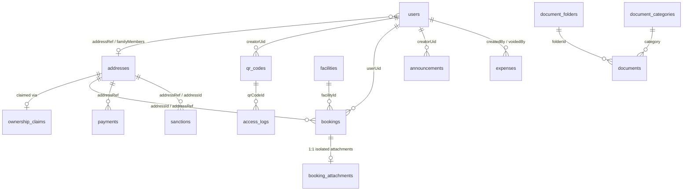

# Database & Storage Schema

Canonical schema across Cloud Firestore, Firebase Realtime Database, and Cloud Storage (aligned with `firestore.rules`, `firestore.indexes.json`, `database.rules.json`, and `storage.rules`).

## Entity Relationships (Firestore)

---

## 1. Cloud Firestore Collections

### `users/{uid}`
- `uid`: `string` (doc ID)
- `name`, `email`: `string`
- `role`: `string` (`'resident' | 'roommate' | 'admin' | 'guard'`) — note multi-role users also carry Auth custom claims
- `addressRef`: `DocumentReference?` (`addresses/{id}`)
- `familyMembers`: `string[]` (roommate UIDs)
- `fcmTokens`: `string[]` (active push registration tokens; stale tokens auto-pruned)

### `addresses/{addressId}` *(e.g. `A-101` or fixed system doc `admin_office`)*
- `addressId`: `string` (doc ID)
- `residentUid`: `string?` (primary resident UID)
- `streetName`: `string` (`'Admin office'` for administration)
- `number`: `number` (house number; `0` for `admin_office`)
- `paymentStatus`: `string` (`'paid' | 'pending' | 'restricted' | 'reviewing'`) — `pending` with `isWithinGracePeriod: true` grants resident access
- `isWithinGracePeriod`: `boolean`
- `hasActiveSanctions`: `boolean`, `activeSanctionsCount`: `number`
- `deliveryDate`: `timestamp`, `lastPaymentApproval`: `timestamp`

### `qr_codes/{codeId}`
- `codeId`, `creatorUid`, `guestName`, `qrData`: `string`
- `accessCategory`: `string` (`'visitor' | 'supplier'`), `isOneTimeUse`: `boolean`
- `vehicleType`: `string` (`'car' | 'motorcycle' | 'walking'`), `vehiclePlates`: `string?`, `passengers`: `number?`
- `type`: `string` (`'permanent' | 'temporary'`)
- `status`: `string` (`'active' | 'deactivated (validated|revoked|expired)'`)
- `expiryTime`: `timestamp?` (`null` for permanent), `deactivatedAt`: `timestamp?`
- `expireAt`: `timestamp?` — **7-day TTL** after terminal deactivation/expiration; held `null` for active permanent passes and while `isInside == true`
- `isInside`: `boolean?` (live visitor inside state), `activeAccessLogId`: `string?`

### `access_logs/{logId}`
- `logId`, `qrCodeId`, `guardUid`, `guardName`, `creatorUid`: `string`
- `status`: `string` (`'allowed' | 'denied'`), `reason`: `string`
- `visitorIdPhotoUrl`: `string`, `visitorPlatePhotoUrl`: `string?`
- `timestamp`: `timestamp` (entry), `exitTimestamp`: `timestamp?`
- `isInside`: `boolean`, `exitGuardUid`: `string?`, `exitGuardName`: `string?`, `exitReason`: `string?`
- `expireAt`: `timestamp` — **60-day TTL** (`timestamp + 60d`, refreshed to `exitTimestamp + 60d` on exit)

### `bookings/{bookingId}`
- `bookingId`, `facilityId`, `userUid`, `addressId`: `string` (`addressId` enforces household cooldown/quota)
- `addressRef`: `DocumentReference?`
- `startTime`, `endTime`: `timestamp`
- `status`: `string` (`'pending review' | 'rejected' | 'cancelled' | 'approved (upcoming)' | 'approved (in use)' | 'closed'`)
- `isConfirmed`: `boolean` (allows neighbor read for schedule calendar without exposing PII)
- `hasAttachments`: `boolean`, `attachmentCount`: `number`, `attachmentsPurgedAt`: `number?` (epoch ms)
- `notes`: `string`, `rejectionReason`: `string?`, `approvalMessage`: `string?`

### `booking_attachments/{bookingId}` *(1:1 with `bookings/{id}`; household & admin isolated)*
- `bookingId`, `facilityId`, `userUid`: `string`, `addressId`: `string?`
- `bookingEndTime`: `number` (epoch ms, indexed for cron fallback sweep)
- `expireAt`: `timestamp` — **30-day TTL** (`endTime + 30d`; exempted from single-field index)
- `attachments`: `map[]` — `{ facilityDocId, title, requirementMode ('mandatory_return'|'optional_return'), fileName, fileType ('pdf'|'doc'|'docx'|'xls'|'xlsx'|'jpg'|'jpeg'|'png'|'webp'), fileSize (<=10MB), url, storagePath, uploadedAt }`
- `createdAt`, `updatedAt`: `timestamp`

### `payments/{paymentId}`
- `paymentId`, `residentUid`, `uploaderUid`, `folio`, `period`: `string`
- `addressRef`: `DocumentReference`
- `periods`: `string[]` (`['YYYY-MM', ...]`)
- `amount`: `number`, `timestamp`, `paymentDate`: `timestamp | number`
- `concept`: `string` (`'monthly quota' | 'sanction'`), `sanctionId`: `string?`
- `status`: `string` (`'paid' | 'pending' | 'approved' | 'rejected'`), `rejectionReason`: `string?`, `receiptUrl`: `string?`

### `sanctions/{sanctionId}`
- `id`, `addressId`, `residentUid`, `streetName`, `reason`, `evidenceUrl`, `createdBy`: `string`
- `addressRef`: `DocumentReference`, `authorizedUids`: `string[]` (primary + roommates)
- `number`, `amount`: `number`
- `status`: `string` (`'active' | 'pending_review' | 'paid' | 'cancelled'`)
- `paymentId`: `string?`, `rejectionReason`: `string?`
- `createdAt`: `timestamp`, `resolvedAt`: `timestamp?`

### `ownership_claims/{claimId}`
- `claimId`, `userUid`, `proofUrl`: `string`, `addressRef`: `DocumentReference`
- `deliveryDate`, `timestamp`: `timestamp`
- `status`: `string` (`'pending' | 'pending review' | 'approved' | 'rejected'`)

### `facilities/{facilityId}`
- `id`, `name`, `openingTime` (`HH:mm`), `closingTime` (`HH:mm`): `string`, `presetApprovalMessage`: `string?`
- `isUnique`: `boolean`, `quantity`: `number`
- `restrictionType`: `string` (`'unrestricted' | 'cooldown' | 'quota'`)
- `cooldownUnit`: `string` (`'unrestricted' | 'hours' | 'days' | 'months' | 'years'`), `cooldownValue`: `number`
- `quotaPeriod`: `string` (`'unrestricted' | 'daily' | 'monthly' | 'yearly'`), `quotaLimit`: `number`
- `anticipationUnit`: `string` (`'unrestricted' | 'hours' | 'days' | 'weeks'`), `anticipationValue`: `number`
- `facilityDocuments`: `map[]` (`{ docId, title, requirementMode ('mandatory_return'|'optional_return'|'informative'), fileName, fileType, fileSize, url, storagePath, uploadedAt }`)

### `expenses/{expenseId}` *(Admin Read-Only; Written Only via Cloud Functions)*
- `id`, `productOrService` (<=200), `billablePeriod` (`YYYY-MM`), `vendorName` (<=120), `notes` (<=500), `createdBy`, `createdByName`: `string`
- `category`: `string` (`'maintenance' | 'gardening' | 'security' | 'utilities' | 'repairs' | 'supplies' | 'other'`)
- `amount`: `number`, `expenseDate`, `createdAt`: `number` (epoch ms)
- `source`: `string?` (`'manual' | 'bulk_csv_import'`)
- `productEvidence`: `map?` (`jpg|jpeg|png|webp`), `receiptEvidence`: `map?` (`jpg|jpeg|png|webp|pdf`) — `{ fileName, fileType, fileSize, url, storagePath, uploadedAt }` under `expenses/<createdBy>/` (required for `createExpense`; `null` for `bulk_csv_import`)
- `status`: `string` (`'active' | 'voided'`)
- `voidedBy`, `voidedByName`, `voidReason` (3–300 chars): `string?`, `voidedAt`: `number?`, `updatedAt`: `timestamp`

### `announcements/{announcementId}`
- `announcementId`, `title`, `content`, `creatorUid`: `string`, `imageUrl`, `thumbnailUrl`: `string?`
- `translatedTitles`, `translatedContents`: `map<string, string>` (`en`, `es` via Vertex AI)
- `targetAudience`: `string` (`'all' | 'residents' | 'specific_uid'`), `readBy`: `string[]`, `timestamp`: `timestamp`

### Transparency (`document_categories`, `document_folders`, `documents`)
- **`document_categories/{catId}`**: `catId`, `name`, `localizedNames` (`{ en, es }?`), `createdAt`, `updatedAt?`
- **`document_folders/{folderId}`**: `folderId`, `name`, `nameKey?` (e.g. `financial_reports`, `official_manuals`), `localizedNames?`, `parentId` (`'root'` or folder ID), `visibility` (`'all' | 'admin'`), `createdAt`, `createdBy`
- **`documents/{docId}`** *(financial summaries use `financial_summary_<start>[_to_<end>]`)*: `docId`, `title`, `translatedTitles?`, `fileName`, `fileType`, `fileSize`, `url`, `storagePath`, `translatedFiles?` (`{ locale: { url, storagePath, fileName, fileSize } }`), `category`, `visibility` (`'all' | 'admin'`), `folderId`, `uploaderUid`, `publicationDate`, `uploadedAt`

### `config/{configId}`
- **`app_settings`** *(authenticated read)*: `paymentCutoffDay` (default `1`), `gracePeriodDays` (`10`), `timeZone` (`'America/Mexico_City'`), `scanOnExitEnabled` (`false`), `initialBudgetBalance` (`0`), `initialBalancePeriod?` (`YYYY-MM`), `paymentRejectionReasons` (`string[]`), `updatedAt`
- **`smtp_settings`** *(admin-only)*: `enabled`, `secure`: `boolean`; `host`, `user`, `pass`, `senderEmail?`, `senderName?`, `customSubject?`, `customBody?`: `string`; `port`: `number`; `updatedAt`

---

## 2. Firebase Realtime Database (`database.rules.json`)

Client reads are owner-only (`auth.uid === $uid`); notifications cannot be created/edited by clients except leaf `isRead` / `readAt` updates or deletion.

- **`/notifications/{uid}/{notificationId}`** *(indexed on `createdAt`, `isRead`; pruned weekly by `cleanupOldRtdbNotifications` at **30 days / 100 items**)*:
  - `type` (<=64), `category` (`reviews | sanctions | qr_access | roommates | transparency | announcements | admin_reviews`), `titles` (`{ es, en }` <=200), `bodies` (`{ es, en }` <=500), `targetRoute` (<=64), `entityId?` (<=128), `createdAt` (epoch ms), `isRead` (`boolean`), `readAt?` (`number`), `metadata?` (primitive map).
- **`/user_notification_settings/{uid}`**:
  - `locale` (`'es' | 'en'`), `pushEnabled`, `inAppBannerEnabled`: `boolean`, `updatedAt` (`number`), `categories`: `{ [category]: boolean }`.

---

## 3. Cloud Storage Paths (`storage.rules`)

All write-gated buckets enforce `< 10 MB` limit (`isValidUploadSize`). SVG/HTML uploads are disallowed for facility docs, booking attachments, and expense evidence.

| Prefix | Read Access | Write / Delete Access | Notes / Allowed Types |
| :--- | :--- | :--- | :--- |
| `/documents/admin_only/**` | Admin | Admin | Pipeline manuals (`docs_pipeline.yml`) |
| `/documents/**` | Admin, or Resident/Roommate if `metadata.visibility != 'admin'` | Admin | Public & translated Transparency docs |
| `/announcements/**` | Authenticated | Admin | Announcement banners & thumbnails |
| `/facility_documents/{facilityId}/**` | Authenticated | Admin | `pdf`, `doc/x`, `xls/x`, `jpg/png/webp` |
| `/booking_attachments/{userId}/**` | Admin or owner `uid` | Admin or owner `uid` | Booking doc modes; 30d TTL + **125d GCS lifecycle** |
| `/sanctions/{addressId}/**` | Authenticated | Admin | `image/*` or `application/pdf` |
| `/payments/{ownerOrAddressId}/**` | Admin or owner/uploader | Create/Update: Admin or owner; Delete: Admin | `image/*` or `application/pdf` |
| `/expenses/{uploaderUid}/**` | Admin | Admin (`uid == uploaderUid`) | `pdf`, `jpg/png/webp` |
| `/ownership_proofs/{userId}/**` | Admin or owner `uid` | Admin or owner `uid` | Deleted on claim approval/rejection |
| `/visitor_ids/**`, `/visitor_plates/**` | Guard or Admin | Create/Update: Guard or Admin; Delete: Admin | Deleted via `onAccessLogDeleted` + **62d GCS lifecycle** |

---

## 4. Composite Indexes & TTL Exemptions (`firestore.indexes.json`)

**33 Composite Indexes:**

| Collection | Count | Indexed Field Tuples |
| :--- | :---: | :--- |
| `bookings` | 10 | `(facilityId, addressId, startTime)`, `(facilityId, userUid, startTime)`, `(facilityId, userUid, startTime, status)`, `(facilityId, status)`, `(facilityId, status, startTime)`, `(facilityId, startTime, status)`, `(facilityId, startTime)`, `(userUid, startTime DESC)`, `(userUid, date DESC)`, `(userUid, facilityId, createdAt)` |
| `access_logs` | 6 | `(creatorUid, timestamp DESC)`, `(accessCategory, timestamp DESC)`, `(status, timestamp DESC)`, `(qrCodeId, timestamp DESC)`, `(qrCodeId, isInside)`, `(isInside, timestamp DESC)` |
| `documents` | 6 | `(category, uploadedAt DESC)`, `(category, publicationDate DESC)`, `(folderId, uploadedAt DESC)`, `(category, createdAt DESC)`, `(visibility, uploadedAt DESC)`, `(visibility, folderId)` |
| `payments` | 4 | `(addressRef, period DESC)`, `(residentUid, timestamp DESC)`, `(uploaderUid, createdAt DESC)`, `(status, timestamp DESC)` |
| `qr_codes` | 3 | `(creatorUid, timestamp DESC)`, `(creatorUid, createdAt DESC)`, `(status, timestamp DESC)` |
| `expenses` | 2 | `(status, billablePeriod DESC, createdAt DESC)`, `(billablePeriod, createdAt DESC)` |
| `ownership_claims` | 1 | `(status, timestamp DESC)` |
| `users` | 1 | `(role, name)` |

**3 TTL Policies & `fieldOverrides` (`indexes: []` single-field exemptions preventing write hotspots):**
1. `access_logs.expireAt` (**60d**): TTL triggers `onAccessLogDeleted` (purges `visitor_ids/`, `visitor_plates/`, heals `qr_codes.isInside`); dedicated weekly cron `cleanupExpiredAccessLogs` (`0 2 * * 0`, `America/Mexico_City`) calls `purgeExpiredAccessLogs`.
2. `qr_codes.expireAt` (**7d** post-deactivation/expiry; `null` while permanent active or `isInside`): TTL + dedicated daily cron `cleanupExpiredQrCodes` (`15 0 * * *`, `America/Mexico_City`) calling `expireOutdatedQrCodes` (`'active'` / `'valid'`) and `purgeExpiredQrCodes`.
3. `booking_attachments.expireAt` (**30d** post-booking `endTime`): TTL triggers `onBookingAttachmentDeleted` (purges `booking_attachments/` + stamps `bookings.attachmentsPurgedAt`); dedicated weekly cron `cleanupExpiredBookingAttachments` (`30 2 * * 0`, `America/Mexico_City`) calls `purgeExpiredBookingAttachments` querying indexed `bookingEndTime`.
