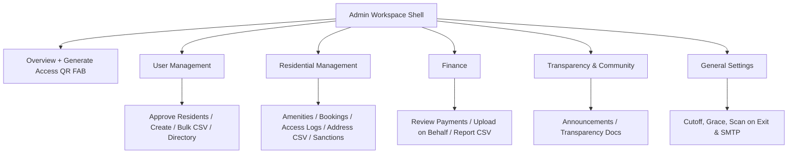
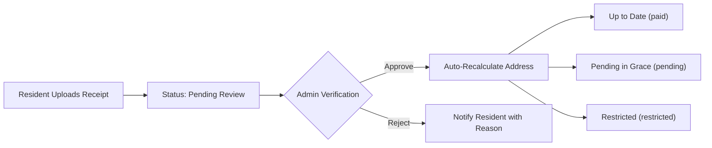

# Suburban Life — Administrator User Manual

Welcome to the **Suburban Life Administrator User Manual**. This comprehensive guide documents every administrative capability available in the platform, including property and user onboarding, financial oversight, sanctions enforcement, facility and booking management, security and gatehouse controls, transparency document publishing, community announcements, and system-wide configuration.

---

## Table of Contents

1. [System Access & Admin Dashboard](#1-system-access--admin-dashboard)
2. [Property & Address Management](#2-property--address-management)
3. [Resident Onboarding & User Management](#3-resident-onboarding--user-management)
4. [Financial & Payment Management](#4-financial--payment-management)
5. [Sanctions & Infractions Management](#5-sanctions--infractions-management)
6. [Security, Guards & Access Control](#6-security-guards--access-control)
7. [Facilities, Amenities & Booking Approvals](#7-facilities-amenities--booking-approvals)
8. [Transparency Portal & Document Management](#8-transparency-portal--document-management)
9. [Community Announcements & AI Translations](#9-community-announcements--ai-translations)
10. [System Configuration & Rules](#10-system-configuration--rules)

---

## 1. System Access & Admin Dashboard

### 1.1 Accessing the Admin Panel
The **Admin Panel** is restricted to users with the `admin` Firebase Custom Claim. When you sign in with an administrator account, Suburban Life routes you to the adaptive **Admin Workspace Shell** (`AdminShellScreen`), which displays a persistent left navigation sidebar on desktop/wide screens (`>= 900px`) and a collapsible hamburger **Navigation Drawer** on mobile devices (`< 900px`).

### 1.2 Top App Bar & Session Controls
At the top-right of the branded purple Admin AppBar (`AppConfig.primaryColor`), role-switching quick-action icons are available for dual-role accounts, while session sign-out is pinned to the bottom of the navigation panel:
* **Switch Between Admin & Resident View** (`Icons.person` / `Icons.admin_panel_settings`): Available in the top-right AppBar only if your account holds both `admin` and `resident` roles. Toggling switches seamlessly between the **Admin Panel** and your personal **Resident Home** dashboard without signing out.
* **Resign Admin Role** (`Icons.waving_hand`): Available in the top-right AppBar only if your account holds both `admin` and `resident` roles. Allows you to voluntarily step down from your administrative role; confirming the dialog removes your `admin` privilege and transitions your account to a standard `resident` role.
* **Logout** (`Icons.logout`): Pinned to the bottom of the left navigation sidebar (on desktop) or mobile navigation **Drawer**, signing you out of your current session.

### 1.3 Real-Time Roll-Up Notification Badges
Real-time Firestore streams drive live notification counters across the **Overview** screen and the collapsible sidebar categories:
1. **Approve Residents** (*User Management*): Number of pending property ownership claims (`ownership_claims`).
2. **Review Bookings** (*Residential Management*): Number of facility reservation requests awaiting approval (`bookings` with `status == 'pending review'`).
3. **Review Pending Payments** (*Finance*): Number of uploaded payment receipts awaiting verification (`payments` with `status == 'pending'`).

When a sidebar category is collapsed, pending counts roll up onto the category header icon; expanding the category moves the badge onto the specific child menu item.

### 1.4 Navigation Drawer Hierarchy & Overview
The Admin Workspace opens on **Overview**—displaying **Pending Approvals**, **Live Community Status** (**Visitors currently inside**, shown only when **Scan on exit** is enabled in General Settings, and **Active Sanctions**; on mobile `< 900px`, both **Pending Approvals** and **Live Community Status** become expandable/collapsible cards so **Shortcuts** remain immediately accessible), six **Shortcuts** cards (*Create User*, *User Directory*, *Create Announcement*, *Upload Payment on Behalf*, *Download Payment Report*, and *Settings*), and a floating **Generate Access QR** button (shown exclusively on the Overview screen)—and organizes all modules into four collapsible sidebar groups plus a direct single-tap **General Settings** item:
* **User Management**: *Approve Residents*, *Create User*, *Bulk User Import (CSV)*, *Manage Users & Roles*.
* **Residential Management**: *Manage Amenities*, *Review Bookings*, *Access History & Logs*, *Bulk Address Import (CSV)*, *Sanctions Management*.
* **Finance**: *Review Pending Payments*, *Upload Payment (Admin)*, *Download Payment Report (CSV)*.
* **Transparency & Community**: *Manage Announcements*, *Manage Transparency Docs*.
* **General Settings** *(Direct item)*: Expandable/collapsible settings cards with real-time auto-save (cutoff & grace periods, timezone, Scan on exit, rejection templates) and manual saving for SMTP server credentials and custom welcome email templates.

---

## 2. Property & Address Management

Before residents can claim a home or be linked to a property, the residential units must exist in the platform's `addresses` catalog.

### 2.1 Bulk Address Import (CSV / TXT)
**Navigation:** Admin Panel $\rightarrow$ **Bulk Address Import (CSV)** (`AdminBulkAddressImportScreen`)

This tool generates dozens or hundreds of residential units in seconds by expanding street number ranges.

#### Supported File Formats & Delimiters
* Accepts `.csv` and `.txt` files (UTF-8 BOM is stripped automatically).
* **Auto-Detected Delimiters**: Comma (`,`), semicolon (`;`), or tab (`\t`).
* **Flexible Column Headers**: Header names are matched case-insensitively (`street` / `streetName` / `calle`, `initialNumber` / `start` / `desde`, `finalNumber` / `end` / `hasta`, `number` / `numero`, `exclusions` / `exclusiones`). If no header row is present, positional columns are used automatically.

#### CSV Columns
| Column | Description | Example |
| :--- | :--- | :--- |
| `street` | Street name | `Etna` |
| `initialNumber` | Starting house number in the range (or single house number) | `1` |
| `finalNumber` | Ending house number in the range (optional if importing a single number) | `25` |
| `exclusions` | Optional space- or comma-separated house numbers to skip within the range | `13 17` |

#### Import Workflow
1. Tap **Select CSV File** and pick your `.csv` or `.txt` file.
2. The screen displays a **Preview List** showing each street range, excluded numbers, and the **Total Computed Addresses** to be generated.
3. Tap **Run Bulk Import**.
4. The `adminBulkImportAddresses` Cloud Function creates all missing address documents while safely skipping any addresses that already exist, then reports the exact **Created** and **Skipped** counts.

---

## 3. Resident Onboarding & User Management

Suburban Life provides four complementary workflows for onboarding and managing users.

### 3.1 Create Single User
**Navigation:** Admin Panel $\rightarrow$ **Create User** (`AdminCreateUserScreen`)

Use this screen to manually register an individual user account:
1. **Select Role**:
   * **Resident**: Requires selecting an available residential address.
   * **Security Guard**: Creates a gatehouse staff account (`guard` role).
   * **Administrator**: Creates a full administrator account (`admin` role) and automatically binds it to the fixed `"Admin office"` address.
2. **Enter Credentials**:
   * Provide **Full Name**, **Email Address**, and **Password**.
   * Passwords must be at least **8 characters** and include an uppercase letter, a lowercase letter, a number, and a special character.
   * Tap the **Auto-Generate Password** wand icon (`Icons.auto_fix_high`) inside the password field to generate a compliant random password with one tap.
3. **Address & Delivery Date (Residents Only)**:
   * Select the **Street** and **House Number** from the cascading dropdowns. Units that are already occupied are labeled `[Claimed]` and disabled so they cannot be double-booked.
   * **Property Delivery Date (Optional)**: Tap the date picker to record when the property was officially handed over to the resident (cannot be a future date). Billing obligations only apply from the delivery date forward.
   * Newly linked resident addresses start with `paymentStatus: 'paid'` so you have time to upload historical payment receipts before the daily midnight payment status check runs.
4. **Submit**:
   * Tap **Create User**. If the **SMTP Email Service** is enabled in System Settings, the user automatically receives a personalized welcome email with their credentials, and an `(Email Sent)` confirmation appears in the snackbar.

---

### 3.2 Bulk User Import (CSV)
**Navigation:** Admin Panel $\rightarrow$ **Bulk User Import (CSV)** (`AdminBulkUserImportScreen`)

Use this module to onboard an entire street or phase of residents at once.

#### SMTP Status Indicator
At the top of the screen, a live **SMTP Status Badge** indicates whether automated welcome emails are **Active** (users will automatically receive their credentials by email) or **Inactive** (you must distribute the generated passwords manually after import).

#### CSV Format & Header Aliases
* Supports `.csv` and `.txt` with comma (`,`), semicolon (`;`), or tab (`\t`) delimiters.
* Recognized header aliases (or positional columns `Name, Email, Password, Street, Number`):
  * **Name**: `name`, `fullName`, `nombre`
  * **Email**: `email`, `correo`, `mail`
  * **Password** *(optional)*: `password`, `contraseña`, `pass`, `clave` — if left blank, the server generates a secure temporary password automatically.
  * **Street** *(optional)*: `street`, `streetName`, `calle`
  * **Number** *(optional)*: `number`, `houseNumber`, `numero`

#### Execution & Post-Import Actions
1. Tap **Select CSV File**, review the parsed rows in the preview list, and tap **Run Bulk Import**.
2. Once processing finishes, an **Import Summary Dialog** displays each user's status (`Success` or `Failed`), their assigned password, linked address, and email delivery badge (`Email Sent`, `Email Failed`, or `Skipped`).
3. Use the three export buttons at the bottom of the dialog to save credentials before closing:
   * **Download CSV**: Saves `user_import_results.csv` to your device.
   * **Copy CSV**: Copies the full result table (`Email,Name,Password,Status,Address,Error`) to the clipboard.
   * **Copy All Passwords**: Copies a clean summary list of all successfully created accounts and their passwords.

---

### 3.3 Approve Resident Ownership Claims
**Navigation:** Admin Panel $\rightarrow$ **Approve Residents** (`AdminResidentApprovalScreen`)

When a self-registered user claims an unlinked address in the app, they upload a photo of their ownership document (e.g., deed, utility bill, or contract) and specify their **Property Delivery Date**.

1. Review the applicant's **Name**, **Email**, **Claimed Address (Street & Number)**, and **Property Delivery Date**.
2. Inspect the **Ownership Proof Image** (tap or pinch-to-zoom to inspect details).
3. Choose an action:
   * **Approve**: Grants the `resident` role, binds the user to the address, stores the `deliveryDate` on the address document, initializes `paymentStatus: 'paid'`, and deletes the ownership claim.
   * **Reject**: Declines the claim and deletes the pending request so the user can submit a corrected claim.

> [!IMPORTANT]
> **Privacy-by-Design Storage Cleanup**: Whether you **Approve** or **Reject** a claim, Suburban Life automatically deletes the sensitive ownership proof image from Firebase Cloud Storage immediately after the decision is recorded.

---

### 3.4 User Directory & Role Management
**Navigation:** Admin Panel $\rightarrow$ **Manage Users** (`AdminUserManagementScreen`)

The **Manage Users** directory gives administrators full visibility and control over every account in the community.

#### Search, Filtering & Pagination
* **Whole-Database Search Bar**: Search across the entire Firestore `users` collection by **Name**, **Email**, or **Address** (with automatic debounce).
* **Street Filter Dropdown**: Filter the directory to show only residents on a specific street.
* **Role Segmented Filter**: Filter by **All**, **Resident**, **Roommate**, **Admin**, or **Guard**.
* **Cursor Pagination**: When browsing unfiltered results, users load in pages of 20. Tap **Load More Users** at the bottom of the list to fetch the next batch.

#### User Summary Card Information
To prevent accidental misclicks while browsing or scrolling, each user in the directory list renders as a compact summary card **without inline action buttons**, displaying:
* **Full Name**, **Email**, and **Role Badge** (`ADMIN`, `GUARD`, `RESIDENT`, `ROOMMATE`, or `UNVERIFIED`).
* **Linked Address** (`Street #Number`) and **Real-Time Payment Status Badge** (`Paid`, `Pending`, `Reviewing`, or `Restricted`).
* **Property Delivery Date**: Shows the recorded handover date for the resident's property (or `Not configured`).

#### Dedicated User Account Details Screen (`AdminUserDetailScreen`)
Tap any user summary card to open **User Account Details**, which separates standard operations from sensitive actions:
1. **Change User Password** (`Icons.lock_reset`): Force-resets the user's Firebase Authentication password (`adminUpdatePassword`). Requires a strong password.
2. **Promote to Admin / Revoke Admin** (`Icons.security` / `Icons.shield_outlined`): Grants or revokes the `admin` role via `setCustomUserClaims`. *(Hidden on Security Guard accounts to prevent addressless role conversion, and self-demotion is blocked here to prevent accidental lockouts; use the AppBar **Resign Admin** button if stepping down).*
3. **Set / Edit Delivery Date** (`Icons.edit_calendar`): Opens a date picker to set or update the `deliveryDate` on the user's linked address without altering its current `paymentStatus` (pending payments are evaluated exclusively by the daily scheduled `checkMonthlyPaymentStatuses` Cloud Function).
4. **Unbind Address** *(Sensitive Actions — `Icons.link_off`)*: Detaches the resident (and any associated roommates) from their current address after confirmation, resetting the unit to unclaimed status (`unbindAddress`).
5. **Remove Account** *(Sensitive Actions — `Icons.delete_forever`)*: Permanently deletes the user from Firebase Authentication and Firestore (`adminDeleteUser`) after confirmation, unbinding any linked property and returning automatically to the directory. *(Self-deletion is blocked).*

---

## 4. Financial & Payment Management

Suburban Life automates monthly maintenance quota tracking, multi-period payment proofs, and historical financial reporting.

### 4.1 Review Pending Payments
**Navigation:** Admin Panel $\rightarrow$ **Review Payments** (`AdminPaymentApprovalScreen`)

Whenever a resident (or roommate) uploads a payment receipt—or when an administrator uploads a receipt for their own residential unit—it enters the **Pending Payments** queue.

#### Inspecting a Submission
The **Review Payments** list displays compact summary cards showing basic address-level payment information (**Physical Address** `Street #Number`, **Payment Amount Badge**, **Concept Chip**, and **Payment Date**) without inline approval buttons to prevent accidental misclicks. Tap any payment card to open its dedicated **Payment Detail Screen** (`AdminPaymentDetailScreen`), which uses the full vertical screen space in a linear layout displaying:
* **Physical Address** (`Street #Number`).
* **Payment Amount Badge** (e.g., `$1,200.00`).
* **Concept Chip**: Indicates whether the receipt is for a **Monthly Quota** (`monthly_quota`) or a **Sanction Fine** (`sanction`).
* **Folio Chip**: Unique transaction or bank reference number.
* **Payment Date Chip**: Date the payment was made.
* **Covered Periods Chips**: Lists every billing month (`YYYY-MM`) covered by a single receipt when a resident pays multiple months at once.
* **Receipt Thumbnail & Full-Screen Rotatable Viewer**: Displays an expanded clickable preview thumbnail of the proof of payment that fills the middle vertical space of the screen. Tap anywhere on the thumbnail to open a full-screen viewer with 20% padding, pinch-to-zoom (`4.0x` magnification), and a rotate button (`90°` increments) to inspect receipts regardless of camera orientation.

#### Approving or Rejecting a Payment
* **Approve**: Marks the payment as `approved`.
  * If the payment is a **Sanction**, the linked sanction document is automatically marked `paid` (`resolvedAt` timestamped).
  * The platform immediately recalculates the address's overall `paymentStatus` (restoring `paid` status if all required periods and active sanctions are now settled).
* **Segregation of Duties (Self-Approval Block)**: If the payment receipt was uploaded by **your own user account** (`uploaderUid == currentAdminUid`), the **Approve** button is disabled and labeled **Cannot self-approve**. A second administrator must review and approve your receipt.
* **Reject**: Opens the **Reject Payment Dialog** where you select a standardized rejection reason:
  * Built-in reasons: *Period Mismatch*, *Amount Mismatch*, *Address Mismatch*, *Folio Mismatch*.
  * Any custom rejection reasons configured in **System Settings**.
  * *Other*: Opens a custom text field to type a specific explanation.
  * Rejecting a **Sanction** payment automatically reverts the sanction back to `active` status and recalculates the property's restriction state.

---

### 4.2 Upload Payment on Behalf of a Resident
**Navigation:** Admin Panel $\rightarrow$ **Upload Payment** (`AdminUploadPaymentScreen`)

When a resident pays in person, by bank transfer directly to administration, or needs historical receipts recorded during onboarding:

1. **Select Street & House Number**: Pick the target property. Each house number shows whether it is `[Linked]` to a resident or `[Available]`.
2. **Verify or Edit Property Delivery Date**: Once an address is selected, an info banner displays its **Property Delivery Date**. You can tap the edit icon (`Icons.edit_calendar`) right on this banner to set or adjust the delivery date, which immediately updates the list of billable months below.
3. **Enter Payment Amount**: Enter the total amount paid (`$`).
4. **Select Covered Billing Periods**: Tap one or more `YYYY-MM` period chips to link the single receipt to all months covered by the payment (generated dynamically from the property's delivery date up to 12 months in advance).
5. **Attach Receipt Image**: Capture a photo with the camera or select an image from your gallery/files.
6. **Upload & Auto-Approve**:
   * When uploading on behalf of **another resident's address**, the receipt is marked `approved` immediately and updates the property's `paymentStatus`.
   * When uploading for **your own residential address**, the system automatically sets the status to `pending` so another administrator can verify it.

---

### 4.3 Payment Matrix CSV Reports
**Navigation:** Admin Panel $\rightarrow$ **Download Payment Report** (`AdminPaymentReportScreen`)

Generate a complete financial audit matrix across all community addresses:
1. Select the **Start Month** and **End Month** (supports up to 22 months in the past and 2 months into the future; defaults to a 6-month window).
2. Tap **Download CSV**.
3. The system evaluates every address against every month in your selected range—accounting for each property's `deliveryDate`, approved multi-period payments, the global `paymentCutoffDay`, and `gracePeriodDays`—and downloads a localized CSV spreadsheet (`payment_report_YYYY-MM_to_YYYY-MM.csv`) classifying each cell as **Paid**, **Pending**, or **Past Due**.

---

## 5. Sanctions & Infractions Management

**Navigation:** Admin Panel $\rightarrow$ **Sanctions** (`AdminSanctionsScreen`)

Administrators can enforce community bylaws by issuing monetary sanctions backed by photographic evidence.

### 5.1 Filtering Sanctions
Use the top filter bar to filter community sanctions by status:
* **All**
* **Active** (Unpaid; currently restricting the property)
* **Pending Review** (Resident uploaded a payment receipt awaiting verification in *Review Payments*)
* **Paid** (Settled and approved)
* **Cancelled** (Waived by an administrator)

### 5.2 Issuing a New Sanction
1. Tap the **+ Issue Sanction** floating action button.
2. **Select Target Address**: Choose the offending property from the sorted address dropdown. The platform automatically resolves the homeowner and all registered roommates at that address (`authorizedUids`) so everyone in the household is notified and can view/pay the fine.
3. **Reason / Infraction Description**: Describe the rule violation clearly.
4. **Fine Amount ($ MXN)**: Enter the monetary penalty amount.
5. **Photographic Evidence**: Attach a mandatory photo of the infraction using your camera or photo library.
6. Tap **Issue Sanction**.

> [!WARNING]
> **Automatic Feature Restriction**: Issuing an active sanction immediately triggers `recalculatePaymentStatusForAddress` and sets the property's status to **`restricted`** (`hasActiveSanctions: true`). While restricted, residents at that address cannot book community amenities or generate temporary visitor QR passes until the sanction is either paid and approved or waived.

### 5.3 Waiving / Cancelling a Sanction
If a sanction was issued in error or resolved through mediation:
1. Locate the `Active` sanction card in the **Sanctions** screen.
2. Tap **Waive Sanction** at the bottom of the card and confirm the prompt.
3. The sanction status changes to `cancelled` (recording your admin UID in `cancelledBy` and a `resolvedAt` timestamp), and the property's `paymentStatus` is immediately recalculated to lift restrictions if no other overdue quotas or active sanctions exist.

---

## 6. Security, Guards & Access Control

### 6.1 Manage Security Guards
**Navigation:** Admin Panel $\rightarrow$ **Manage Users** (`AdminUserManagementScreen`) $\rightarrow$ **Guard** Role Filter

* Select the **Guard** chip in the role filter bar to view all accounts holding the `guard` role.
* **Add a New Guard**: Tap the **Create User** (`Icons.person_add_alt_1`) shortcut button in the top AppBar (which automatically pre-selects the **Security Guard** role when filtering by `Guard`), or navigate to **Admin Panel $\rightarrow$ Create User**.
* **Reset Guard Password**: Tap the **Change Password** (`Icons.lock_reset`) icon on any guard card to set or auto-generate a new password via `adminUpdatePassword`.
* **Remove Guard Account**: Tap the **Delete User** (`Icons.delete_forever`) icon next to any guard and confirm. This invokes `adminDeleteUser` to permanently remove their Firebase Authentication account and Firestore user profile, immediately revoking their access to the Gatehouse Scanner.

### 6.2 Audit Access Logs
**Navigation:** Admin Panel $\rightarrow$ **Access Logs** (`AdminAccessLogsScreen`)

Provides a comprehensive, searchable audit dashboard of every physical entry processed at the gatehouse (`access_logs`):

#### Search, Multi-Filter & Pagination Controls
* **Whole-Database Keyword Search**: Search across the entire `access_logs` collection by **Guest/Visitor Name**, **Vehicle License Plates**, **Destination Address**, **Host Resident Name**, **Guard Name**, or **Reason / Notes** (with automatic debounce).
* **Destination Address Dropdown**: Filter logs for a specific residential property (`Street #Number`) or view **All Addresses**.
* **Visitor Category Selector**: Filter by **All Types**, **Guest (`visitor`)**, or **Supplier / Provider (`supplier`)**.
* **Date Range Filter Chips**: Filter by **All Dates**, **Today**, **This Week**, **This Month**, or pick a **Custom Date Range** via the calendar range selector.
* **20-Record Batch Exploration vs. Database Search**: When browsing without active filters, logs load in batches of **20 records** (tap **Load More** at the bottom to fetch the next batch). When any search query or filter is active, the screen queries the entire database for matching records.

#### Real-Time KPI Summary Cards
Four live metric cards at the top of the screen summarize the currently displayed records:
1. **Total Accesses**
2. **Allowed Accesses**
3. **Denied Accesses**
4. **Provider / Supplier Accesses**

#### Access Log Card Details & Photo Evidence
Each log card displays:
* **Status Badge** (`Allowed` in green or `Denied` in red) and **Visitor Category Badge** (`Guest` in blue or `Supplier` in orange).
* **Entry Metadata**: Visitor Name, Destination Address, Invited by Resident, Verified by Guard, Vehicle Details (`CAR` / `MOTORCYCLE`, License Plates, and Passenger Count), and Guard Reason / Notes.
* **Interactive Photo Evidence**: Tap **View Visitor ID Photo** (`visitorIdPhotoUrl`) or **View Plate Photo** (`visitorPlatePhotoUrl`) to inspect the captured identification and vehicle license plate photos in a full-screen pinch-to-zoom dialog.

### 6.3 Generate Visitor QR Access
**Navigation:** Admin Panel $\rightarrow$ **Generate QR Access** (`QrGeneratorScreen`)

Administrators can generate visitor or supplier QR passes directly from the Admin Panel (automatically associated with the **Admin Office**):
* **Guest Name**: Full name of the visitor or contractor.
* **Access Category**:
  * **Visitor (`visitor`)**: Configurable as a **Temporary** pass (with custom expiration date/time) or **Permanent** pass.
  * **Supplier / Contractor (`supplier`)**: Automatically configured as a **one-time-use** pass valid until `23:59:59` on the day of creation.
* **Vehicle & Entry Details**: Select **Car**, **Motorcycle**, or **Walking**. For vehicles, specify **License Plates** and **Passenger Count**.
* **Share Branded QR Card**: Once generated, export or share a high-contrast branded Suburban Life QR pass image directly with the visitor.

---

## 7. Facilities, Amenities & Booking Approvals

Suburban Life includes a rule-driven reservation engine for community spaces such as clubhouses, pools, grills, and courts.

### 7.1 Manage Facilities & Reservation Rules
**Navigation:** Admin Panel $\rightarrow$ **Manage Facilities** (`AdminFacilitiesScreen`)

You can **Create** a new facility using the top form, **Edit** any existing facility in-place (`Icons.edit`), or **Delete** a facility (`Icons.delete`).

#### Configurable Facility Parameters
1. **Facility Name**: Display name of the amenity (e.g., *Palapa Principal*, *Tennis Court*).
2. **Capacity Type**:
   * **Unique Amenity (`quantity = 1`)**: Only one reservation can occupy a given time slot.
   * **Multi-item Amenity (`quantity = N`)**: Allows up to `N` concurrent reservations during the same time slot (e.g., 4 Pergolas or 3 Grill stations).
3. **Daily Operating Hours Window**:
   * **Opening Time** and **Closing Time** (defaults to `08:00` – `21:00`). Closing time must be strictly after opening time. Residents can only request slots within this daily window.
4. **Cooldown Rule (Frequency Limit)**:
   * Prevents a single household from monopolizing high-demand amenities.
   * Choose **Unrestricted**, or enforce a waiting period measured in **Days**, **Months**, or **Years** (e.g., *15 Days* between bookings of the same facility).
5. **Advance Booking Anticipation Rule**:
   * Enforces minimum advance notice before a reservation start time.
   * Choose **Unrestricted**, or require a minimum number of **Hours**, **Days**, or **Weeks** in advance (e.g., *48 Hours* advance notice required to book the Event Hall).
6. **Preset Approval Instructions (`presetApprovalMessage`)**:
   * Optional template text (such as security deposit instructions, key pickup rules, or cleaning checklists) that automatically pre-fills the approval message box whenever an administrator approves a booking for this facility.

---

### 7.2 Review & Approve Bookings
**Navigation:** Admin Panel $\rightarrow$ **Review Bookings** (`AdminBookingApprovalScreen`)

When a resident requests a reservation, it enters the `pending review` queue:
1. Inspect the booking card, which displays the **Facility Name**, **Requested Date & Time Window**, and an **Applicant Contact Card** (**Name**, **Email**, and **Phone Number**).
2. Choose an action:
   * **Approve**: Opens the **Approve Booking Dialog**, pre-populated with the facility's **Preset Approval Instructions**. You can customize the instructions for this specific resident before confirming. Approving transitions the booking to `approved` and makes your instructions visible to the resident in their *My Bookings* screen.
   * **Reject**: Prompts you to enter a **Rejection Reason**, transitions the booking to `rejected`, and frees the time slot for other residents.

---

## 8. Transparency Portal & Document Management

**Navigation:** Admin Panel $\rightarrow$ **Manage Transparency Documents** (`TransparencyScreen`)

The **Transparency Portal** provides a structured virtual file system for sharing financial statements, bylaws, vendor contracts, meeting minutes, and internal administrative manuals.

### 8.1 Virtual Folders & Breadcrumb Navigation
* **Breadcrumb Bar**: Shows your current location in the folder hierarchy (`/ [Root] / Folder Name`). Tap any breadcrumb segment to jump back to that parent folder.
* **Create Virtual Folder**: Tap the **New Folder** icon (`Icons.create_new_folder_outlined`) to create a subfolder inside the currently open directory.
* **Delete Folder**: Empty or obsolete virtual folders can be removed using the delete icon on the folder tile.

### 8.2 Uploading Documents & Role-Based Visibility
1. Tap the **+ Upload** floating action button inside the target folder.
2. Select any file from your device:
   * **Markdown (`.md`) & Text (`.txt`)**: Rendered natively in-app using the built-in `DocumentViewerScreen` with adjustable font-size scaling.
   * **Images (`.png`, `.jpg`, `.jpeg`, `.webp`, `.gif`)**: Displayed in-app with full-screen pinch-to-zoom inspection.
   * **Binary Documents (`.pdf`, `.docx`, `.xlsx`, etc.)**: Cached locally via `DocumentCacheService` for fast repeat viewing and opened with the device's native viewer or browser tab.
3. Enter the **Document Title**, select a **Category**, and pick the official **Publication Date**.
4. **Select Document Visibility (`visibility`)**:
   * **All (Residents & Admins) (`all`)**: Visible to all verified residents and administrators.
   * **Administrators Only (`admin`)**: Restricted exclusively to administrators (enforced across the UI, Firestore security rules, and Cloud Storage `/documents/admin_only/`). Admin-only documents display a red **`ADMIN ONLY`** lock badge on their card.

### 8.3 Per-Document Admin Actions
Each document tile includes a context menu (`⋮`) for administrators:
* **Change Category**: Reassign the document to a different category without re-uploading.
* **Change Visibility**: Switch a document's visibility between **All (Residents & Admins)** and **Administrators Only** at any time.
* **Move to Folder**: Relocate the document to `/ [Root]` or any existing virtual folder.
* **Delete Document**: Permanently removes the Firestore metadata record, deletes the file from Firebase Cloud Storage, and purges the local cache.

### 8.4 Dynamic Category Management
Tap the **Manage Categories** icon (`Icons.category_outlined`) at the top of the screen to customize document classifications:
* **Default Categories**: Automatically seeded with *Normatives*, *Contracts*, *Financial*, and *Communiques*.
* **Add Category**: Create new custom categories at any time.
* **Rename Category**: Rename an existing category; all documents assigned to that category automatically update to the new name in a single batch operation.
* **In-Use Deletion Protection**: Each category displays how many documents currently use it. Categories with `1` or more assigned documents cannot be deleted until those documents are reassigned or removed.

---

## 9. Community Announcements & AI Translations

**Navigation:** Admin Panel $\rightarrow$ **Manage Announcements** (`AnnouncementsScreen`)

Publish official notices to residents and security personnel with automatic bilingual translation and read tracking.

### 9.1 Creating an Announcement
Tap the **+ New Announcement** floating action button to open the composer:
1. **Title & Content**: Write the announcement in either Spanish or English.
2. **Quick Emoji Bar**: Tap any of the 20 curated community emojis (`📢`, `⚠️`, `🚨`, `📅`, `🎉`, `🛠️`, `🚧`, `💧`, `⚡`, `🔒`, `🔑`, `🚗`, `🐕`, `🌳`, `🏊`, `🗑️`, `📦`, `💳`, `✅`, `❤️`) to insert it directly at your active cursor position in either the Title or Content field.
3. **Image Attachment & Clipboard Paste**:
   * Tap **Attach Image** to pick a photo from your device, **or**
   * Copy any image/screenshot to your system clipboard and tap **Paste Image** (or press `Ctrl+V` / `Cmd+V`).
   * **Automatic Dual-Resolution Optimization**: Upon publishing, the app automatically generates an orientation-aware `600px` preview thumbnail (`_thumb.png`) for fast feed scrolling alongside the full-resolution image (`_full.jpg`) for full-screen pinch-to-zoom inspection.
4. **Target Audience Selector**:
   * **All Users (`all`)**: Visible to both Residents and Security Guards.
   * **Residents Only (`residents`)**: Visible exclusively to verified Residents and Roommates.

### 9.2 Automated AI Translation & Read Receipts
* **Bilingual Gemini AI Translation**: A background Cloud Function (`translateAnnouncement`) automatically translates your announcement title and body into both English and Spanish (`translations.en` and `translations.es`), displaying the matching language for each user's device locale.
* **Read Tracking**: As users open announcements, their UID is recorded in `readBy`, clearing their unread notification badge.
* **Deleting Announcements**: Administrators can delete outdated announcements using the trash icon on any card, which also deletes both the thumbnail and full-resolution images from Cloud Storage.

---

## 10. System Configuration & Rules

**Navigation:** Admin Panel $\rightarrow$ **General Settings** (`AdminSettingsScreen`)

Centralized configuration organized into five **expandable/collapsible cards** for fast navigation. Switches and general settings persist **automatically in real time** (indicated by the top auto-save status banner); manual saving is required only for **SMTP Server Configuration** and the **Custom Welcome Message** template.

### 10.1 Payment Cutoff, Grace Period & Timezone (`config/app_settings`)
* **Payment Cutoff Day (`1` – `28`)**: The day of each month when maintenance fees become due *(auto-saves on slider release)*.
* **Grace Period (`0` – `30` Days)**: Additional days after the cutoff day before an unpaid property transitions from `pending` to `restricted` *(auto-saves on slider release)*.
* **Schedule Timezone**: Select the canonical IANA timezone governing the daily `00:00` automated payment recalculation job (`checkMonthlyPaymentStatuses`), auto-saving immediately upon selection:
  * `America/Mexico_City` (CST — Central Time)
  * `America/Cancun` (EST — Quintana Roo)
  * `America/Tijuana` (PST — Pacific Time)
  * `America/Hermosillo` (MST — Sonora)
  * `UTC`

### 10.2 Access Control & QR (`config/app_settings`)
* **Scan on exit (`scanOnExitEnabled`)**: Toggling this switch updates in real time. When enabled, security guards scan visitor/supplier QR passes upon departure to record exit timestamps, and the **Visitors currently inside** KPI appears on the Admin Overview screen.

### 10.3 Custom Payment Rejection Reason Pool (`config/app_settings`)
Manage the list of reusable rejection reasons presented when reviewing payment proofs *(auto-saves immediately when adding or removing reasons)*:
* Type a new reason in the **Add Rejection Reason** field and tap **`+`**.
* Remove outdated custom reasons by tapping the **`×`** on their chip.
* Built-in base reasons (*Period Mismatch*, *Amount Mismatch*, *Address Mismatch*, *Folio Mismatch*, and *Other*) are always preserved alongside your custom reasons.

### 10.4 SMTP Email Service & Welcome Email Template (`config/smtp_settings`)
Configure automated email delivery across two collapsible cards for new user onboarding (Single User Creation and Bulk CSV Import):
1. **Enable Automatic Welcome Emails & Use SSL/TLS Switches**: Both switches auto-save in real time without overwriting unsaved edits in the text fields.
2. **SMTP Server Card (Manual Save)**:
   * **SMTP Host** (e.g., `smtp.gmail.com`, `smtp.office365.com`).
   * **SMTP Port** with quick-select presets: `587 (TLS - Recommended)`, `465 (SSL)`, or `25 (Unencrypted)`, plus the **Use SSL/TLS** switch.
   * **SMTP Username**, **Password / App Password**, **Sender Email**, and **Sender Display Name**.
   * Tap **Test Connection** to invoke `adminTestSmtpConnection` and send a live test email, then tap **Save SMTP Configuration** to persist server credentials.
3. **Custom Welcome Message Card (Manual Save)**:
   * Customize the **Email Subject** and **Email Body**.
   * Click any **Dynamic Placeholder Chip** to insert live variables (`%name%`, `%email%`, `%password%`, `%address%`, `%role%`, `%appName%`).
   * Tap **Save Email Template** to persist your custom welcome email subject and body.
