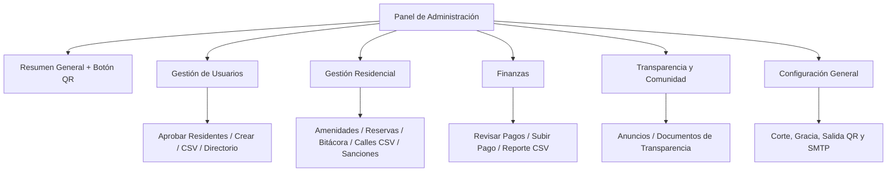
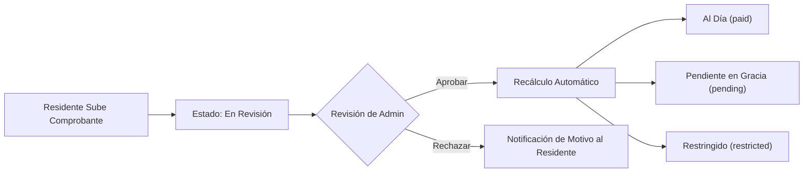

# Suburban Life — Manual de Usuario para Administradores

Bienvenido al **Manual de Usuario para Administradores de Suburban Life**. Esta guía documenta de manera integral todas las herramientas administrativas disponibles en la plataforma, incluyendo el alta de propiedades y residentes, control financiero, aplicación de sanciones, gestión de amenidades y reservas, seguridad en caseta, portal de transparencia, comunicados comunitarios y configuración global del sistema.

---

## Tabla de Contenidos

1. [Acceso al Sistema y Panel de Administración](#1-acceso-al-sistema-y-panel-de-administración)
2. [Gestión de Propiedades y Direcciones](#2-gestión-de-propiedades-y-direcciones)
3. [Alta de Residentes y Gestión de Usuarios](#3-alta-de-residentes-y-gestión-de-usuarios)
4. [Gestión Financiera y de Pagos](#4-gestión-financiera-y-de-pagos)
5. [Gestión de Sanciones e Infracciones](#5-gestión-de-sanciones-e-infracciones)
6. [Seguridad, Guardias y Control de Acceso](#6-seguridad-guardias-y-control-de-acceso)
7. [Amenidades, Instalaciones y Aprobación de Reservas](#7-amenidades-instalaciones-y-aprobación-de-reservas)
8. [Portal de Transparencia y Gestión Documental](#8-portal-de-transparencia-y-gestión-documental)
9. [Comunicados Comunitarios y Traducción con IA](#9-comunicados-comunitarios-y-traducción-con-ia)
10. [Configuración y Reglas del Sistema](#10-configuración-y-reglas-del-sistema)

---

## 1. Acceso al Sistema y Panel de Administración

### 1.1 Acceso al Panel de Administración
El **Panel de Administración** está restringido exclusivamente a usuarios con el privilegio `admin` en Firebase Custom Claims. Al iniciar sesión con una cuenta de administrador, Suburban Life te dirige al entorno adaptable **Admin Workspace Shell** (`AdminShellScreen`), el cual muestra una barra lateral izquierda fija en pantallas amplias o de escritorio (`>= 900px`) y un **Menú Lateral (Drawer)** desplegable mediante el ícono de hamburguesa en dispositivos móviles (`< 900px`).

### 1.2 Controles de la Barra Superior (AppBar) y Cierre de Sesión
En la esquina superior derecha de la barra morada institucional (`AppConfig.primaryColor`) se muestran controles rápidos para cuentas con doble rol, mientras que el botón de cierre de sesión se ubica en la parte inferior del panel de navegación:
* **Cambiar entre Vista de Administrador y Residente** (`Icons.person` / `Icons.admin_panel_settings`): Disponible en la esquina superior derecha únicamente cuando tu cuenta posee simultáneamente los roles `admin` y `resident`. Permite alternar al instante entre el **Panel de Administración** y tu pantalla personal de **Inicio de Residente** sin cerrar sesión.
* **Renunciar al Rol de Administrador** (`Icons.waving_hand`): Disponible en la esquina superior derecha únicamente cuando tu cuenta posee simultáneamente los roles `admin` y `resident`. Permite dejar voluntariamente el cargo de administrador; al confirmar el diálogo, se revoca el privilegio `admin` y tu cuenta conserva únicamente el rol de `resident`.
* **Cerrar Sesión** (`Icons.logout`): Fijado en la parte inferior de la barra lateral izquierda (en escritorio) o del **Menú Lateral (Drawer)** en dispositivos móviles para finalizar tu sesión actual de forma segura.

### 1.3 Insignias Acumuladas en Tiempo Real
Flujos en tiempo real de Firestore alimentan contadores dinámicos tanto en el **Resumen General** como en las categorías desplegables del menú lateral:
1. **Aprobar Residentes** (*Gestión de Usuarios*): Solicitudes pendientes de validación de propiedad (`ownership_claims`).
2. **Revisar Reservas** (*Gestión Residencial*): Solicitudes de reserva de amenidades pendientes de aprobación (`bookings` con `status == 'pending review'`).
3. **Revisar Pagos Pendientes** (*Finanzas*): Comprobantes de pago pendientes de verificación (`payments` con `status == 'pending'`).

Cuando una categoría del menú lateral está contraída, las notificaciones pendientes se agrupan en el ícono del encabezado; al expandir la categoría, el contador se traslada al submenú correspondiente.

### 1.4 Jerarquía del Menú Lateral y Resumen General
El Panel de Administración abre por defecto en **Resumen General** —mostrando **Aprobaciones Pendientes**, **Estado de la Comunidad en Vivo** (**Visitantes actualmente dentro**, visible únicamente cuando **Escanear para salir** está activado en Configuración General, y **Sanciones Activas**; en vista móvil `< 900px`, tanto **Aprobaciones Pendientes** como **Estado de la Comunidad en Vivo** se muestran como secciones desplegables para mantener los **Accesos Rápidos** a la vista), seis tarjetas de **Accesos Rápidos** (*Crear Usuario*, *Directorio de Usuarios*, *Crear Anuncio*, *Subir Pago a Nombre de Usuario*, *Descargar Reporte de Pagos* y *Configuración*) y el botón flotante **Generar Acceso QR** (exclusivo de la vista Resumen General)— y organiza las herramientas en cuatro categorías desplegables más un acceso directo a **Configuración General**:
* **Gestión de Usuarios**: *Aprobar Residentes*, *Crear Usuario*, *Importación Masiva de Usuarios (CSV)*, *Gestionar Usuarios y Roles*.
* **Gestión Residencial**: *Gestionar Amenidades*, *Revisar Reservas*, *Historial de Accesos y Bitácora*, *Importación Masiva de Direcciones (CSV)*, *Gestión de Sanciones*.
* **Finanzas**: *Revisar Pagos Pendientes*, *Subir Pago (Admin)*, *Descargar Reporte de Pagos (CSV)*.
* **Transparencia y Comunidad**: *Gestionar Anuncios*, *Gestionar Documentos de Transparencia*.
* **Configuración General** *(Acceso directo)*: Tarjetas desplegables con guardado automático en tiempo real (días de corte y gracia, zona horaria, Escanear para salir y motivos de rechazo) y guardado manual para el servidor SMTP y la plantilla de bienvenida.

---

## 2. Gestión de Propiedades y Direcciones

Antes de que los residentes puedan reclamar una vivienda o ser vinculados a una propiedad, los domicilios deben existir en el catálogo `addresses` de la plataforma.

### 2.1 Importación Masiva de Direcciones (CSV / TXT)
**Navegación:** Panel de Administración $\rightarrow$ **Importación Masiva de Direcciones (CSV)** (`AdminBulkAddressImportScreen`)

Esta herramienta permite generar decenas o cientos de lotes y viviendas en segundos expandiendo rangos de numeración por calle.

#### Formatos y Delimitadores Soportados
* Acepta archivos `.csv` y `.txt` (elimina automáticamente la marca UTF-8 BOM).
* **Detección Automática de Delimitador**: Coma (`,`), punto y coma (`;`) o tabulador (`\t`).
* **Encabezados Flexibles**: Reconoce encabezados sin importar mayúsculas/minúsculas (`street` / `streetName` / `calle`, `initialNumber` / `start` / `desde`, `finalNumber` / `end` / `hasta`, `number` / `numero`, `exclusions` / `exclusiones`). Si el archivo no tiene fila de encabezados, utiliza columnas posicionales automáticamente.

#### Columnas del Archivo CSV
| Columna | Descripción | Ejemplo |
| :--- | :--- | :--- |
| `street` | Nombre de la calle | `Etna` |
| `initialNumber` | Número inicial del rango (o número único de vivienda) | `1` |
| `finalNumber` | Número final del rango (opcional si es un solo número) | `25` |
| `exclusions` | Números separados por espacio o coma que deben omitirse dentro del rango | `13 17` |

#### Flujo de Importación
1. Toca **Seleccionar archivo CSV** y elige tu archivo `.csv` o `.txt`.
2. La pantalla mostrará una **Vista Previa** con cada rango de calle, las exclusiones detectadas y el **Total de Direcciones Calculadas**.
3. Toca **Ejecutar Importación Masiva**.
4. La Cloud Function `adminBulkImportAddresses` creará todas las direcciones nuevas omitiendo de forma segura las que ya existan, e informará el conteo exacto de domicilios **Creados** y **Omitidos**.

---

## 3. Alta de Residentes y Gestión de Usuarios

Suburban Life ofrece cuatro flujos complementarios para el registro y administración de usuarios.

### 3.1 Crear Usuario Individual
**Navegación:** Panel de Administración $\rightarrow$ **Crear Usuario** (`AdminCreateUserScreen`)

Utiliza esta pantalla para registrar manualmente una cuenta individual:
1. **Seleccionar Rol**:
   * **Residente**: Requiere asignar un domicilio disponible del catálogo.
   * **Guardia de Seguridad**: Crea una cuenta para personal de caseta (rol `guard`).
   * **Administrador**: Crea una cuenta administrativa completa (rol `admin`) y la vincula automáticamente al domicilio fijo `"Admin office"`.
2. **Ingresar Credenciales**:
   * Captura **Nombre Completo**, **Correo Electrónico** y **Contraseña**.
   * La contraseña debe tener al menos **8 caracteres**, incluyendo una letra mayúscula, una minúscula, un número y un carácter especial.
   * Toca el ícono de **Generar Contraseña Automática** (`Icons.auto_fix_high`) dentro del campo de contraseña para crear una clave segura con un solo toque.
3. **Domicilio y Fecha de Entrega (Solo Residentes)**:
   * Selecciona la **Calle** y el **Número** en las listas desplegables en cascada. Las viviendas que ya están ocupadas aparecen con la etiqueta `[Reclamada]` y deshabilitadas para evitar duplicidades.
   * **Fecha de Entrega de la Propiedad (Opcional)**: Selecciona la fecha en que la vivienda fue entregada oficialmente al residente (no permite fechas futuras). Las obligaciones de pago solo se calculan a partir de esta fecha de entrega.
   * Los domicilios recién vinculados inician con estatus `paymentStatus: 'paid'` (Pagado) para darte tiempo de subir su historial de recibos antes de la verificación automática nocturna.
4. **Guardar**:
   * Toca **Crear Usuario**. Si el **Servicio de Correo SMTP** está activo en la Configuración del Sistema, el usuario recibirá automáticamente un correo de bienvenida con sus credenciales de acceso.

---

### 3.2 Importación Masiva de Usuarios (CSV)
**Navegación:** Panel de Administración $\rightarrow$ **Importación Masiva de Usuarios (CSV)** (`AdminBulkUserImportScreen`)

Ideal para dar de alta calles completas o etapas enteras de residentes en una sola operación.

#### Indicador de Estado SMTP
En la parte superior de la pantalla, una **Insignia de Estado SMTP** muestra en vivo si el envío automático de correos está **Activo** (los residentes recibirán sus contraseñas por correo automáticamente) o **Inactivo** (deberás descargar o copiar las contraseñas generadas al finalizar la importación).

#### Formato CSV y Alias de Columnas
* Soporta archivos `.csv` y `.txt` delimitados por coma (`,`), punto y coma (`;`) o tabulador (`\t`).
* Reconoce los siguientes encabezados (o columnas posicionales `Nombre, Correo, Contraseña, Calle, Número`):
  * **Nombre**: `name`, `fullName`, `nombre`
  * **Correo**: `email`, `correo`, `mail`
  * **Contraseña** *(opcional)*: `password`, `contraseña`, `pass`, `clave` — si se deja en blanco, el servidor genera automáticamente una contraseña temporal segura.
  * **Calle** *(opcional)*: `street`, `streetName`, `calle`
  * **Número** *(opcional)*: `number`, `houseNumber`, `numero`

#### Ejecución y Exportación de Resultados
1. Toca **Seleccionar archivo CSV**, revisa la vista previa de filas y presiona **Ejecutar Importación Masiva**.
2. Al concluir, el **Diálogo de Resultados de Importación** mostrará el estado de cada cuenta (`Éxito` o `Error`), la contraseña asignada, el domicilio vinculado y el estado del correo (`Correo Enviado`, `Error de Correo` u `Omitido`).
3. Utiliza los tres botones de exportación en la parte inferior del diálogo antes de cerrarlo:
   * **Descargar CSV**: Guarda el archivo `user_import_results.csv` en tu dispositivo.
   * **Copiar CSV**: Copia la tabla completa de resultados al portapapeles.
   * **Copiar Contraseñas**: Copia un resumen limpio con todas las cuentas creadas exitosamente y sus contraseñas asignadas.

---

### 3.3 Aprobar Solicitudes de Propiedad de Residentes
**Navegación:** Panel de Administración $\rightarrow$ **Aprobar Residentes** (`AdminResidentApprovalScreen`)

Cuando un usuario se registra por su cuenta y reclama un domicilio disponible, sube una fotografía de su documento probatorio (escritura, recibo de servicios o contrato) e indica su **Fecha de Entrega de la Propiedad**.

1. **Explorar Tarjetas de Resumen Pendientes**: La lista de **Aprobar Residentes** muestra tarjetas de resumen compactas con el **Domicilio Solicitado** (`Calle #Número`), insignia **En Revisión**, **Nombre del Solicitante** y **Fecha de Entrega de la Propiedad**, sin botones de acción directos para evitar toques accidentales.
2. **Abrir Pantalla de Detalle (`AdminResidentDetailScreen`)**: Toca cualquier tarjeta para revisar la solicitud en una vista detallada responsiva (lado a lado en pantallas amplias `> 650px`, apilada verticalmente en dispositivos móviles) con el **Encabezado del Domicilio**, **Nombre del Solicitante**, **Correo Enmascarado**, **Fecha de Entrega**, **Fecha de Envío** y la **Vista Previa del Comprobante de Propiedad**.
3. **Rotar y Ampliar Fotografía del Comprobante**:
   * Toca el botón **Rotar (`90°`)** (`Icons.rotate_right`) en la esquina superior derecha de la vista previa para enderezar escrituras o recibos tomados horizontalmente directamente desde la pantalla de detalle.
   * Toca cualquier parte de la imagen (o el ícono de **Pantalla Completa**) para abrir el **Visor Interactivo en Pantalla Completa** con margen del 20%, zoom táctil (`4.0x`), desplazamiento y control de rotación de `90°` (conservando la orientación actual).
4. **Elige una Acción**:
   * **Aprobar Residente**: Otorga el rol `resident`, vincula al usuario con el domicilio, guarda la `deliveryDate` en el documento de la propiedad, inicializa `paymentStatus: 'paid'` y elimina la solicitud pendiente.
   * **Rechazar**: Deniega la solicitud y elimina el registro pendiente para que el usuario pueda enviar una nueva solicitud corregida.

> [!IMPORTANT]
> **Privacidad por Diseño (Limpieza Automática en Storage)**: Tanto al **Aprobar** como al **Rechazar** una solicitud, Suburban Life elimina de forma inmediata y permanente la imagen del documento de propiedad de Firebase Cloud Storage.

---

### 3.4 Directorio de Usuarios y Gestión de Roles
**Navegación:** Panel de Administración $\rightarrow$ **Gestionar Usuarios** (`AdminUserManagementScreen`)

El directorio **Gestionar Usuarios** brinda visibilidad y control total sobre todas las cuentas registradas en la comunidad.

#### Búsqueda, Filtros y Paginación
* **Búsqueda en Toda la Base de Datos**: Busca en toda la colección `users` por **Nombre**, **Correo** o **Dirección** (con filtro automático en tiempo real).
* **Filtro por Calle**: Filtra el directorio para mostrar únicamente los residentes de una calle específica.
* **Filtro por Rol**: Filtra mediante botones segmentados por **Todos**, **Residente**, **Roommate**, **Admin** o **Guardia**.
* **Paginación por Cursor**: Al explorar sin filtros activos, los usuarios se cargan en bloques de 20. Toca **Cargar Más Usuarios** al final de la lista para obtener el siguiente bloque.

#### Información en cada Tarjeta de Resumen de Usuario
Para evitar toques accidentales al desplazarse por el directorio, cada usuario en la lista se muestra como una tarjeta de resumen compacta **sin botones de acción directos**, mostrando:
* **Nombre Completo**, **Correo Electrónico** e **Insignia de Rol** (`ADMIN`, `GUARD`, `RESIDENT`, `ROOMMATE` o `UNVERIFIED`).
* **Domicilio Vinculado** (`Calle #Número`) e **Insignia de Estatus de Pago en Tiempo Real** (`Pagado`, `Pendiente`, `En Revisión` o `Restringido`).
* **Fecha de Entrega de la Propiedad**: Muestra la fecha registrada de entrega de la vivienda (o `Sin definir`).

#### Pantalla Dedicada de Datos de la Cuenta (`AdminUserDetailScreen`)
Toca cualquier tarjeta de usuario para abrir **Datos de la Cuenta**, la cual separa las acciones habituales de las acciones sensibles:
1. **Cambiar Contraseña de Usuario** (`Icons.lock_reset`): Restablece la contraseña del usuario en Firebase Authentication (`adminUpdatePassword`) validando los requisitos de seguridad.
2. **Promover a Admin / Revocar Admin** (`Icons.security` / `Icons.shield_outlined`): Otorga o revoca el rol `admin` mediante `setCustomUserClaims`. *(Oculto en cuentas de Guardias de Seguridad para evitar conversiones sin domicilio, y la auto-revocación está bloqueada para evitar bloqueos accidentales; utiliza el botón **Renunciar al Rol de Administrador** en la barra superior si deseas dejar el cargo).*
3. **Definir / Editar Fecha de Entrega** (`Icons.edit_calendar`): Abre un selector de fecha para definir o actualizar la `deliveryDate` del domicilio vinculado sin modificar su `paymentStatus` actual (los pagos pendientes son evaluados exclusivamente por la Cloud Function programada diaria `checkMonthlyPaymentStatuses`).
4. **Desvincular Dirección** *(Acciones Sensibles — `Icons.link_off`)*: Desvincula tras confirmación al propietario (y a sus roommates asociados) del domicilio actual, liberando la propiedad (`unbindAddress`).
5. **Eliminar Cuenta** *(Acciones Sensibles — `Icons.delete_forever`)*: Elimina permanentemente tras confirmación la cuenta de Firebase Authentication y Firestore (`adminDeleteUser`), liberando cualquier propiedad vinculada y regresando automáticamente al directorio. *(La auto-eliminación está bloqueada).*

---

## 4. Gestión Financiera y de Pagos

Suburban Life automatiza el control de cuotas mensuales de mantenimiento, comprobantes multi-periodo y reportes financieros históricos.

### 4.1 Revisar Pagos Pendientes
**Navegación:** Panel de Administración $\rightarrow$ **Revisar Pagos** (`AdminPaymentApprovalScreen`)

Cada vez que un residente (o roommate) sube un comprobante de pago—o cuando un administrador sube un recibo para su propio domicilio particular—el registro ingresa a la cola de **Pagos Pendientes**.

#### Inspección del Comprobante
La lista **Revisar Pagos** muestra tarjetas de resumen con la información básica del pago a nivel domicilio (**Domicilio Físico** `Calle #Número`, **Insignia de Monto**, **Chip de Concepto** y **Fecha de Pago**) sin botones de aprobación directos en la lista para evitar toques accidentales. Toca cualquier tarjeta para abrir su **Pantalla de Detalle de Pago** dedicada (`AdminPaymentDetailScreen`), la cual aprovecha todo el espacio vertical en un diseño lineal mostrando:
* **Domicilio Físico** (`Calle #Número`).
* **Insignia de Monto Pagado** (ej. `$1,200.00`).
* **Chip de Concepto**: Indica si el pago corresponde a una **Cuota Mensual** (`monthly_quota`) o a una **Sanción** (`sanction`).
* **Chip de Folio**: Número de referencia bancaria o folio de transacción.
* **Chip de Fecha de Pago**: Fecha en que se realizó el pago.
* **Chips de Periodos Cubiertos**: Muestra todos los meses (`AAAA-MM`) cubiertos por un mismo comprobante cuando el residente paga varios meses en una sola exhibición.
* **Miniatura del Comprobante y Visor Rotable en Pantalla Completa**: Muestra una vista previa expandida y seleccionable del comprobante ocupando el espacio vertical central de la pantalla. Toca cualquier parte de la miniatura para abrir el visor en pantalla completa con un margen (padding) del 20%, zoom de hasta `4.0x` y un botón para rotar la imagen (`90°` por toque) sin importar la orientación en que fue tomada la fotografía.

#### Aprobar o Rechazar un Pago
* **Aprobar**: Marca el pago como `approved`.
  * Si el pago corresponde a una **Sanción**, el documento de la sanción vinculada pasa automáticamente a estatus `paid` (con marca de tiempo `resolvedAt`).
  * La plataforma recalcula de inmediato el `paymentStatus` del domicilio (restableciendo el estatus `paid` si todos los periodos exigibles y sanciones activas han quedado cubiertos).
* **Segregación de Funciones (Bloqueo de Auto-Aprobación)**: Si el comprobante fue subido por **tu propia cuenta de usuario** (`uploaderUid == currentAdminUid`), el botón **Aprobar** aparecerá deshabilitado con la leyenda **No puedes auto-aprobar**. Otro administrador deberá revisar y aprobar tu comprobante.
* **Rechazar**: Abre el **Diálogo de Rechazo de Pago** para seleccionar un motivo estandarizado:
  * Motivos predeterminados: *Periodo Incorrecto*, *Monto Incorrecto*, *Dirección Incorrecta*, *Folio Incorrecto*.
  * Cualquier motivo personalizado configurado en **Configuración del Sistema**.
  * *Otro*: Permite escribir una explicación personalizada.
  * Si se rechaza el pago de una **Sanción**, la sanción vuelve automáticamente a estatus `active` y se recalcula la restricción del domicilio.

---

### 4.2 Subir Pago en Nombre de un Residente
**Navegación:** Panel de Administración $\rightarrow$ **Subir Pago** (`AdminUploadPaymentScreen`)

Cuando un residente realiza su pago directamente en la administración o necesitas cargar recibos históricos durante el alta inicial:

1. **Seleccionar Calle y Número**: Elige la propiedad. Cada número indica si está `[Vinculada]` a un residente o `[Disponible]`.
2. **Verificar o Editar la Fecha de Entrega**: Al seleccionar el domicilio, un recuadro informativo muestra su **Fecha de Entrega de la Propiedad**. Puedes tocar el ícono de calendario (`Icons.edit_calendar`) ahí mismo para definirla o corregirla, lo cual actualizará al instante los meses seleccionables.
3. **Ingresar el Monto del Pago**: Captura el importe total pagado (`$`).
4. **Seleccionar Periodos Cubiertos**: Marca uno o varios chips de periodo (`AAAA-MM`) para asociar el comprobante a todos los meses cubiertos (generados dinámicamente desde la fecha de entrega de la propiedad hasta 12 meses hacia adelante).
5. **Adjuntar Imagen del Comprobante**: Toma una fotografía con la cámara o selecciona un archivo de tu galería.
6. **Subir y Aprobar Automáticamente**:
   * Al subir un pago para el **domicilio de otro residente**, el pago se registra como `approved` de forma inmediata y actualiza el `paymentStatus` de la propiedad.
   * Al subir un pago para **tu propio domicilio particular**, el sistema lo registra como `pending` para que otro administrador lo valide.

---

### 4.3 Reportes Matriz de Pagos en CSV
**Navegación:** Panel de Administración $\rightarrow$ **Descargar Reporte de Pagos** (`AdminPaymentReportScreen`)

Genera una matriz de auditoría financiera completa de todas las propiedades de la comunidad:
1. Selecciona el **Mes Inicial** y el **Mes Final** (permite consultar hasta 22 meses hacia atrás y 2 meses hacia adelante; por defecto muestra los últimos 6 meses).
2. Toca **Descargar CSV**.
3. El sistema evalúa cada domicilio en cada mes del rango seleccionado—tomando en cuenta su `deliveryDate`, pagos multi-periodo aprobados, el `paymentCutoffDay` y los `gracePeriodDays`—y descarga un archivo CSV localizado (`payment_report_AAAA-MM_to_AAAA-MM.csv`) clasificando cada celda como **Pagado**, **Pendiente** o **Vencido**.

---

## 5. Gestión de Sanciones e Infracciones

**Navegación:** Panel de Administración $\rightarrow$ **Sanciones** (`AdminSanctionsScreen`)

Los administradores pueden hacer cumplir el reglamento interno emitiendo sanciones económicas respaldadas con evidencia fotográfica.

### 5.1 Filtrado de Sanciones
Utiliza la barra superior de filtros para consultar las sanciones por estatus:
* **Todas**
* **Activas** (Pendientes de pago; restringen actualmente los servicios del domicilio)
* **En Revisión** (El residente ya subió un comprobante de pago y está pendiente de validación en *Revisar Pagos*)
* **Pagadas** (Liquidadas y aprobadas)
* **Canceladas** (Condonadas por un administrador)

### 5.2 Emitir una Nueva Sanción
1. Toca el botón flotante **+ Emitir Sanción**.
2. **Seleccionar Domicilio Infractor**: Elige la propiedad en la lista desplegable ordenada. La plataforma identifica automáticamente al propietario y a todos los roommates registrados en esa dirección (`authorizedUids`) para notificarles y permitirles consultar o pagar la multa.
3. **Motivo / Descripción de la Infracción**: Describe con claridad la falta cometida.
4. **Monto de la Multa ($ MXN)**: Ingresa el importe económico de la sanción.
5. **Evidencia Fotográfica**: Adjunta obligatoriamente una fotografía de la infracción desde la cámara o galería.
6. Toca **Emitir Sanción**.

> [!WARNING]
> **Restricción Automática de Servicios**: Al emitir una sanción activa se ejecuta de inmediato `recalculatePaymentStatusForAddress` y el estatus del domicilio cambia a **`restricted`** (`hasActiveSanctions: true`). Mientras el domicilio esté restringido, sus residentes no podrán reservar amenidades ni generar códigos QR temporales para visitantes hasta que la sanción sea pagada y aprobada, o bien condonada.

### 5.3 Condonar / Cancelar una Sanción
Si una sanción fue emitida por error o se resolvió mediante aclaración:
1. Ubica la tarjeta de la sanción con estatus `Activa` en la pantalla de **Sanciones**.
2. Toca el botón **Condonar Sanción** en la parte inferior de la tarjeta y confirma el diálogo.
3. El estatus de la sanción cambiará a `cancelled` (registrando tu UID de administrador en `cancelledBy` y la fecha `resolvedAt`), y el `paymentStatus` del domicilio se recalculará al instante para levantar las restricciones si no existen otros adeudos o sanciones activas.

---

## 6. Seguridad, Guardias y Control de Acceso

### 6.1 Gestionar Guardias de Seguridad
**Navegación:** Panel de Administración $\rightarrow$ **Gestionar Usuarios** (`AdminUserManagementScreen`) $\rightarrow$ Filtro de rol **Guardia**

* Selecciona el botón **Guardia** en el filtro de roles para visualizar todas las cuentas con el rol `guard`.
* **Dar de Alta un Nuevo Guardia**: Toca el botón de acceso directo **Crear Usuario** (`Icons.person_add_alt_1`) en la barra superior (que preselecciona automáticamente el rol **Guardia de Seguridad** cuando el filtro `Guardia` está activo), o ingresa a **Panel de Administración $\rightarrow$ Crear Usuario**.
* **Cambiar Contraseña de Guardia**: Toca el ícono **Cambiar Contraseña** (`Icons.lock_reset`) en la tarjeta de cualquier guardia para asignar o generar automáticamente una nueva contraseña mediante `adminUpdatePassword`.
* **Eliminar Cuenta de Guardia**: Toca el ícono **Eliminar Usuario** (`Icons.delete_forever`) junto a cualquier guardia y confirma. Esto invoca `adminDeleteUser` para eliminar permanentemente su cuenta de Firebase Authentication y su perfil en Firestore, revocando de inmediato su acceso al escáner de caseta.

### 6.2 Auditar Registros de Acceso
**Navegación:** Panel de Administración $\rightarrow$ **Registros de Acceso** (`AdminAccessLogsScreen`)

Ofrece un centro de auditoría completo y consultable con todas las entradas procesadas en la caseta de vigilancia (`access_logs`):

#### Controles de Búsqueda, Filtros Múltiples y Paginación
* **Búsqueda en Toda la Base de Datos**: Busca en toda la colección `access_logs` por **Nombre del Visitante**, **Placas del Vehículo**, **Domicilio de Destino**, **Nombre del Residente Anfitrión**, **Nombre del Guardia** o **Motivo / Notas**.
* **Filtro Desplegable por Domicilio**: Filtra los accesos dirigidos a una propiedad específica (`Calle #Número`) o consulta **Todas las Direcciones**.
* **Selector de Categoría de Visitante**: Filtra por **Todos los Tipos**, **Invitado (`visitor`)** o **Proveedor / Contratista (`supplier`)**.
* **Chips de Rango de Fechas**: Filtra por **Todas las Fechas**, **Hoy**, **Esta Semana**, **Este Mes** o selecciona un **Rango de Fechas Personalizado** mediante el calendario.
* **Exploración por Bloques de 20 vs. Búsqueda Global**: Al explorar sin filtros activos, los registros se cargan en bloques de **20 eventos** (toca **Cargar Más** al final de la lista para obtener el siguiente bloque). Cuando se aplica cualquier filtro o texto de búsqueda, el sistema consulta la totalidad de la base de datos.

#### Tarjetas de Indicadores Clave (KPIs) en Tiempo Real
En la parte superior se muestran cuatro indicadores dinámicos calculados sobre los registros mostrados:
1. **Total de Accesos**
2. **Accesos Permitidos**
3. **Accesos Denegados**
4. **Accesos de Proveedores**

#### Detalles del Registro y Evidencia Fotográfica
Cada tarjeta de registro muestra:
* **Insignia de Estatus** (`Permitido` en verde o `Denegado` en rojo) e **Insignia de Categoría** (`Invitado` en azul o `Proveedor` en naranja).
* **Metadatos del Ingreso**: Nombre del Visitante, Domicilio de Destino, Residente que Invita, Guardia que Verificó, Detalles del Vehículo (`AUTO` / `MOTOCICLETA`, Placas y Número de Pasajeros) y Motivo o Notas de Caseta.
* **Evidencia Fotográfica Interactiva**: Toca **Ver Foto de Identificación** (`visitorIdPhotoUrl`) o **Ver Foto de Placas** (`visitorPlatePhotoUrl`) para inspeccionar en pantalla completa con zoom las fotografías capturadas en caseta.

> [!NOTE]
> **Política de Eliminación Automática de 2 Meses (60 Días)**: Para proteger la privacidad de los visitantes y optimizar el almacenamiento en la nube, los registros de `access_logs` y sus fotografías de identificación y placas asociadas (`visitor_ids/**` y `visitor_plates/**`) se eliminan de forma automática y permanente **60 días** después de la fecha de entrada (o 60 días después de la salida registrada cuando **Escanear para salir** está activo).

### 6.3 Generar Acceso QR para Visitantes
**Navegación:** Panel de Administración $\rightarrow$ **Generar Acceso QR** (`QrGeneratorScreen`)

Los administradores pueden generar pases QR para visitantes o proveedores directamente desde el Panel de Administración (vinculados automáticamente a la **Oficina de Administración**):
* **Nombre del Invitado**: Nombre completo del visitante o proveedor.
* **Categoría de Acceso**:
  * **Visitante (`visitor`)**: Configurable como pase **Temporal** (con fecha y hora de expiración personalizadas) o **Permanente**.
  * **Proveedor (`supplier`)**: Se configura automáticamente como un pase de **un solo uso** válido hasta las `23:59:59` del día de su creación.
* **Tipo de Vehículo y Detalles**: Selecciona **Automóvil**, **Motocicleta** o **Peatón**. Para vehículos, permite registrar **Placas** y **Número de Pasajeros**.
* **Compartir Tarjeta QR con Marca**: Una vez generado el código, puedes descargar o compartir una tarjeta visual con el logotipo de Suburban Life lista para enviarse al visitante.
* **Limpieza Automática de 7 Días para Pases QR Inactivos**: Los pases QR finalizados (temporales vencidos, de proveedor ya utilizados y revocados) se eliminan automáticamente **7 días** después de su vencimiento o desactivación, mientras que los **pases permanentes activos** no vencen salvo que sean revocados manualmente.

---

## 7. Amenidades, Instalaciones y Aprobación de Reservas

Suburban Life incorpora un motor de reservas basado en reglas para espacios comunes como palapas, albercas, asadores y canchas.

### 7.1 Gestionar Instalaciones y Reglas de Reserva
**Navegación:** Panel de Administración $\rightarrow$ **Gestionar Instalaciones** (`AdminFacilitiesScreen`)

Puedes **Crear** una nueva instalación desde el formulario superior, **Editar** cualquier instalación existente (`Icons.edit`) o **Eliminarla** (`Icons.delete`).

#### Parámetros Configurables por Instalación
1. **Nombre de la Instalación**: Nombre visible de la amenidad (ej. *Palapa Principal*, *Cancha de Pádel*).
2. **Tipo de Capacidad**:
   * **Amenidad Única (`quantity = 1`)**: Solo permite una reserva activa por horario.
   * **Amenidad Múltiple (`quantity = N`)**: Permite hasta `N` reservas simultáneas en el mismo horario (ej. 4 Pérgolas o 3 Asadores).
3. **Ventana de Horario Operativo Diario**:
   * **Hora de Apertura** y **Hora de Cierre** (por defecto `08:00` – `21:00`). La hora de cierre debe ser posterior a la de apertura. Los residentes solo podrán solicitar horarios dentro de esta ventana.
4. **Política de Restricción de Reserva (Tiempo de Espera o Cuota por Domicilio)**:
   * Evita que un mismo domicilio (compartido entre el residente titular y todos los cohabitantes vinculados a la misma propiedad) acapare las amenidades de alta demanda. Tanto las reservas en revisión (`pending review`) como las confirmadas (`approved` / `closed`) cuentan para el límite; las reservas rechazadas (`rejected`) o canceladas (`cancelled`) no cuentan.
   * Elige una de tres políticas mutuamente excluyentes:
     * **Sin restricción (Sin límite)**: No aplica tiempo de espera ni límite de cuota.
     * **Tiempo de espera (Esperar después de reservar)**: Exige un intervalo mínimo medido desde la **hora de término** de una reserva hasta la **hora de inicio** de la siguiente en **Horas**, **Días**, **Meses** o **Años** (ej. *Esperar 4 Horas* o *Esperar 7 Días* antes de iniciar otra reserva).
     * **Cuota de reservas (Máximo por periodo)**: Limita a cada domicilio a un máximo de `X` reservas por periodo calendario **Diario**, **Mensual** o **Anual** (evaluado en la zona horaria configurada de la comunidad, ej. *2 reservas al mes*).
5. **Regla de Anticipación Mínima de Reserva**:
   * Exige reservar con un tiempo mínimo de antelación antes de la hora de inicio del evento.
   * Elige **Sin restricción**, o solicita un mínimo de **Horas**, **Días** o **Semanas** de anticipación (ej. *48 Horas* de anticipación para reservar el Salón de Eventos).
6. **Instrucciones Predeterminadas de Aprobación (`presetApprovalMessage`)**:
   * Texto plantilla opcional (como reglas de depósito en garantía, entrega de llaves o lineamientos de limpieza) que se pre-llenará automáticamente cada vez que un administrador apruebe una reserva de esta instalación.
7. **Documentación de la Amenidad (`facilityDocuments`)**:
   * Permite adjuntar formatos, cartas responsivas, listas de invitados o reglamentos (`PDF`, `DOC`, `DOCX`, `XLS`, `XLSX`, `JPG`, `JPEG`, `PNG`, `WEBP` — máximo **10 MB** por archivo).
   * Asigna un **Tipo de Requisito** a cada documento:
     * **Devolución obligatoria (`mandatory_return`)**: El residente debe descargar el formato, llenarlo y adjuntar el archivo firmado (o tomar fotografía) antes de poder enviar su solicitud de reserva.
     * **Devolución opcional (`optional_return`)**: El residente puede descargar el archivo y adjuntar opcionalmente su documento completado.
     * **Solo informativo (`informative`)**: Documento de consulta/descarga (ej. reglamento de alberca o ruido) que no solicita adjunto de vuelta.

---

### 7.2 Revisar y Aprobar Reservas
**Navegación:** Panel de Administración $\rightarrow$ **Revisar Reservas** (`AdminBookingApprovalScreen`)

Cuando un residente solicita una reserva, esta ingresa a la cola `pending review`:
1. Revisa la tarjeta de la solicitud, que incluye el **Nombre de la Instalación**, **Fecha y Horario Solicitado**, la **Tarjeta de Contacto del Solicitante** (**Nombre**, **Correo** y **Teléfono**) y, cuando el residente envió documentos, la sección **Documentación Enviada** con botones **Ver / Descargar** para inspeccionar cada archivo antes de tomar una decisión.
2. Elige una acción:
   * **Aprobar**: Abre el **Diálogo de Aprobación de Reserva**, pre-llenado con las **Instrucciones Predeterminadas de Aprobación** de esa instalación. Puedes personalizar el mensaje para ese residente antes de confirmar. Al aprobar, la reserva pasa a estatus `approved` y tus instrucciones quedan visibles para el residente en su pantalla *Mis Reservas*.
   * **Rechazar**: Solicita ingresar un **Motivo de Rechazo**, cambia el estatus a `rejected` y libera el horario para otros vecinos. El residente podrá editar y reenviar su solicitud rechazada (incluyendo reemplazar cualquier documento adjunto incompleto o sin firma).

---

## 8. Portal de Transparencia y Gestión Documental

**Navegación:** Panel de Administración $\rightarrow$ **Gestionar Documentos de Transparencia** (`TransparencyScreen`)

El **Portal de Transparencia** ofrece un explorador de archivos virtual estructurado para compartir estados financieros, reglamentos, contratos con proveedores, minutas de asamblea y manuales internos de administración.

### 8.1 Carpetas Virtuales y Barra de Navegación (*Breadcrumbs*)
* **Barra de Ruta (*Breadcrumbs*)**: Muestra tu ubicación actual dentro de la jerarquía de carpetas (`/ [Raíz] / Nombre de Carpeta`). Toca cualquier nivel de la ruta para regresar rápidamente a esa carpeta superior.
* **Crear Carpeta Virtual**: Toca el ícono **Nueva Carpeta** (`Icons.create_new_folder_outlined`) para crear una subcarpeta dentro del directorio actual.
* **Eliminar Carpeta**: Puedes eliminar carpetas virtuales mediante el ícono de papelera en la tarjeta de la carpeta.

### 8.2 Subida de Documentos y Control de Visibilidad por Rol
1. Toca el botón flotante **+ Subir** dentro de la carpeta deseada.
2. Selecciona cualquier archivo de tu dispositivo:
   * **Markdown (`.md`) y Texto (`.txt`)**: Se renderizan de forma nativa dentro de la app mediante `DocumentViewerScreen` con controles para ajustar el tamaño de letra.
   * **Imágenes (`.png`, `.jpg`, `.jpeg`, `.webp`, `.gif`)**: Se abren dentro de la app con visor interactivo de zoom.
   * **Documentos Binarios (`.pdf`, `.docx`, `.xlsx`, etc.)**: Se almacenan en caché local mediante `DocumentCacheService` para aperturas rápidas y se visualizan con el lector nativo del dispositivo o pestaña del navegador.
3. Ingresa el **Título del Documento**, selecciona su **Categoría** y define la **Fecha de Publicación**.
4. **Seleccionar Visibilidad del Documento (`visibility`)**:
   * **Todos (Residentes y Administradores) (`all`)**: Visible para todos los residentes verificados y administradores.
   * **Solo Administradores (`admin`)**: Restringido exclusivamente a cuentas con rol de administrador (protegido tanto en la interfaz como en las reglas de seguridad de Firestore y en la ruta `/documents/admin_only/` de Cloud Storage). Los documentos exclusivos para administradores muestran una insignia roja **`SOLO ADMIN`** con candado.

### 8.3 Acciones Administrativas por Documento
Cada documento cuenta con un menú contextual (`⋮`) para administradores:
* **Cambiar Categoría**: Reasigna el documento a otra categoría sin necesidad de volver a subirlo.
* **Cambiar Visibilidad**: Alterna en cualquier momento la visibilidad de un documento entre **Todos (Residentes y Administradores)** y **Solo Administradores**.
* **Mover a Carpeta**: Traslada el documento a `/ [Raíz]` o a cualquier otra carpeta virtual existente.
* **Eliminar Documento**: Elimina permanentemente el registro en Firestore, borra el archivo en Firebase Cloud Storage y limpia la caché local.

### 8.4 Gestión Dinámica de Categorías
Toca el ícono **Gestionar Categorías** (`Icons.category_outlined`) en la barra superior para administrar las clasificaciones documentales:
* **Categorías Predeterminadas**: Incluye inicialmente *Normativas*, *Contratos*, *Financieros* y *Comunicados*.
* **Agregar Categoría**: Crea nuevas categorías personalizadas en cualquier momento.
* **Renombrar Categoría**: Cambia el nombre de una categoría existente; todos los documentos asociados se actualizan automáticamente al nuevo nombre en una sola operación por lotes.
* **Protección contra Eliminación en Uso**: Cada categoría muestra cuántos documentos tiene asignados. Las categorías con `1` o más documentos no pueden eliminarse hasta que dichos documentos sean cambiados de categoría o eliminados.

---

## 9. Comunicados Comunitarios y Traducción con IA

**Navegación:** Panel de Administración $\rightarrow$ **Gestionar Comunicados** (`AnnouncementsScreen`)

Publica avisos oficiales para residentes y guardias con traducción bilingüe automática y seguimiento de lectura.

### 9.1 Crear un Comunicado
Toca el botón flotante **+ Nuevo Comunicado** para abrir el editor:
1. **Título y Contenido**: Redacta el aviso en español o en inglés.
2. **Barra Rápida de Emojis**: Toca cualquiera de los 20 emojis comunitarios (`📢`, `⚠️`, `🚨`, `📅`, `🎉`, `🛠️`, `🚧`, `💧`, `⚡`, `🔒`, `🔑`, `🚗`, `🐕`, `🌳`, `🏊`, `🗑️`, `📦`, `💳`, `✅`, `❤️`) para insertarlo directamente en la posición actual del cursor, ya sea en el Título o en el Contenido.
3. **Adjuntar Imagen o Pegar desde el Portapapeles**:
   * Toca **Adjuntar Imagen** para elegir una foto de tu galería, **o bien**
   * Copia cualquier imagen o captura de pantalla en tu portapapeles y toca **Pegar Imagen** (o presiona `Ctrl+V` / `Cmd+V`).
   * **Optimización Automática de Doble Resolución**: Al publicar, la aplicación genera automáticamente una miniatura proporcional de `600px` (`_thumb.png`) para una carga rápida en el muro, junto con la imagen en resolución completa (`_full.jpg`) para inspección en pantalla completa con zoom.
4. **Selector de Audiencia Objetivo**:
   * **Todos los Usuarios (`all`)**: Visible tanto para Residentes como para Guardias de Seguridad.
   * **Solo Residentes (`residents`)**: Visible exclusivamente para Residentes y Roommates verificados.

### 9.2 Traducción Automática con IA y Confirmación de Lectura
* **Traducción Bilingüe con Gemini AI**: Una Cloud Function en segundo plano (`translateAnnouncement`) traduce automáticamente el título y el cuerpo del comunicado al inglés y al español (`translations.en` y `translations.es`), mostrando el idioma correspondiente según la configuración de cada usuario.
* **Seguimiento de Lectura**: Cuando un usuario abre un comunicado, su UID se registra en `readBy`, actualizando su contador de avisos no leídos.
* **Eliminar Comunicados**: Los administradores pueden eliminar avisos antiguos tocando el ícono de papelera en la tarjeta, lo cual también borra tanto la miniatura como la imagen de alta resolución en Cloud Storage.

---

## 10. Configuración y Reglas del Sistema

**Navegación:** Panel de Administración $\rightarrow$ **Configuración General** (`AdminSettingsScreen`)

Configuración centralizada organizada en cinco **tarjetas desplegables** para una navegación más ágil. Los interruptores y ajustes generales se **guardan automáticamente en tiempo real** (indicado por el aviso superior de autoguardado); únicamente la **Configuración del Servidor SMTP** y el **Mensaje de Bienvenida Personalizado** requieren guardado manual.

### 10.1 Día de Corte, Periodo de Gracia y Zona Horaria (`config/app_settings`)
* **Día de Corte de Pago (`1` – `28`)**: Día del mes en que vence la cuota de mantenimiento *(se guarda automáticamente al soltar el control deslizante)*.
* **Días de Gracia (`0` – `30` Días)**: Días adicionales posteriores al día de corte antes de que un domicilio sin pago pase de estatus `pending` (Pendiente) a `restricted` (Restringido) *(autoguardado en tiempo real)*.
* **Zona Horaria de Programación**: Define la zona horaria IANA utilizada por la tarea programada diaria de medianoche (`checkMonthlyPaymentStatuses`), guardándose automáticamente al seleccionarla:
  * `America/Mexico_City` (CST — Hora del Centro)
  * `America/Cancun` (EST — Quintana Roo)
  * `America/Tijuana` (PST — Hora del Pacífico)
  * `America/Hermosillo` (MST — Sonora)
  * `UTC`

### 10.2 Control de Acceso y QR (`config/app_settings`)
* **Escanear para salir (`scanOnExitEnabled`)**: Al cambiar este interruptor se guarda en tiempo real. Cuando está activo, los guardias escanean el código QR de visitantes y proveedores al salir para registrar su hora de salida, y se muestra el indicador **Visitantes actualmente dentro** en el Resumen General.

### 10.3 Plantillas de Motivos de Rechazo de Pagos (`config/app_settings`)
Administra el catálogo de motivos reutilizables que aparecen al rechazar un comprobante de pago *(se guarda automáticamente al agregar o eliminar motivos)*:
* Escribe un nuevo motivo en el campo **Agregar Motivo de Rechazo** y presiona **`+`**.
* Elimina motivos personalizados tocando el ícono **`×`** en su chip correspondiente.
* Los motivos base del sistema (*Periodo Incorrecto*, *Monto Incorrecto*, *Dirección Incorrecta*, *Folio Incorrecto* y *Otro*) se conservan siempre disponibles junto con tus motivos personalizados.

### 10.4 Servicio de Correo SMTP y Plantilla de Bienvenida (`config/smtp_settings`)
Configura el envío automático de correos en dos tarjetas desplegables independientes para el alta de usuarios (Creación Individual e Importación Masiva CSV):
1. **Interruptores Habilitar Correos Automáticos y Usar SSL/TLS**: Ambos interruptores se guardan automáticamente en tiempo real sin sobrescribir cambios no guardados en los campos de texto.
2. **Tarjeta Servicio de Correo SMTP (Guardado Manual)**:
   * **Servidor SMTP (Host)** (ej. `smtp.gmail.com`, `smtp.office365.com`).
   * **Puerto SMTP** con botones rápidos: `587 (TLS - Recomendado)`, `465 (SSL)` o `25 (Sin cifrado)`, además del interruptor **Usar SSL/TLS**.
   * **Usuario SMTP**, **Contraseña / Contraseña de Aplicación**, **Correo Remitente** y **Nombre Visible del Remitente**.
   * Toca **Probar Conexión** para ejecutar `adminTestSmtpConnection` y enviar un correo de prueba en vivo, y luego toca **Guardar Configuración SMTP** para almacenar las credenciales del servidor.
3. **Tarjeta Mensaje de Bienvenida Personalizado (Guardado Manual)**:
   * Personaliza el **Asunto del Correo** y el **Cuerpo del Mensaje**.
   * Toca cualquiera de los **Chips de Variables Dinámicas** para insertar datos reales (`%name%`, `%email%`, `%password%`, `%address%`, `%role%`, `%appName%`).
   * Toca **Guardar Plantilla de Correo** para guardar el asunto y cuerpo personalizados.
